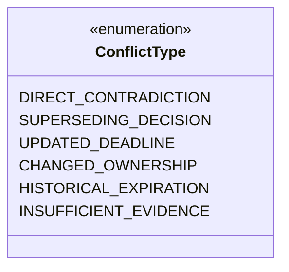

# Relay Checkpoint D — Architecture Audit & Technical Specification
## Evidence-Grounded Intelligence Layer

**Document Version:** 1.0.0
**Status:** Architecture Refined & Approved for Implementation
**Baseline Commit:** `d09aefa` (`feat: implement document parsing and segmentation`)
**Target Milestone:** Milestone 2, Checkpoint D

---

## 1. Executive Summary & Engineering Baseline

Relay is an agentic organizational continuity platform designed to preserve institutional memory, surface unwritten responsibilities, map leadership transitions, and maintain verified organizational knowledge.

### 1.1 Verified Baseline
- **Document Ingestion:** Secure multi-format ingestion (PDF, DOCX, TXT), SHA-256 integrity, physical file storage, and database tracking.
- **Parsing & Segmentation:** Deterministic document segmentation producing ordered, typed `DocumentSegment` records with exact document-relative character offsets satisfying:
  $$\text{Document.extracted\_text}[\text{char\_offset\_start}:\text{char\_offset\_end}] == \text{segment.content}$$
- **Knowledge Schema:** Normalized relational models in SQLAlchemy 2.0 with Alembic migrations (`c24d6592cc4a`, `7dafb2d9743d`, `8eb0985c74e5`):
  - `DocumentSegment` (structural source context)
  - `ExtractedEntity` (canonical cross-document entities across 8 categories)
  - `EntityMention` (surface occurrences and aliases)
  - `ExtractedFact` (assertions across 5 categories, severity, deadlines, verification status)
  - `FactCitation` (verbatim source quotes, segment-relative offsets, check constraints)
  - `EntityRelationship` (directed knowledge graph edges: `TRANSFERS_TO`, `REPORTS_TO`, `OWNS`, `BLOCKS`, `CONTRADICTS`)
  - `FactVerificationLog` (human verification / audit history)
- **LLM Integration:** `GeminiProvider` using Google GenAI SDK (`gemini-3.5-flash`), with bounded exponential retries, credential isolation, and strict timeout controls.
- **Verification:** 54 ordinary tests and 1 live Gemini integration test passing with 0 errors.

---

## 2. Citation Grounding Architecture

### 2.1 Core Grounding Invariants
> **Fundamental Law of Relay:** A model-generated statement without valid, verified source evidence must never be presented or stored as an established fact.

Every fact extraction must adhere to these mathematical invariants:
1. **Coordinate System Separation:**
   - `DocumentSegment.char_offset_start` & `char_offset_end` are **document-relative**, 0-based offsets into `Document.extracted_text`.
   - `FactCitation.char_start` & `char_end` are **segment-relative**, 0-based, end-exclusive offsets into `DocumentSegment.content`.
   - The two coordinate systems must never be intermixed.
2. **Exact Slicing Invariant:**
   For every stored `FactCitation`:
   $$0 \le \text{char\_start} < \text{char\_end} \le \text{len}(\text{DocumentSegment.content})$$
   $$\text{DocumentSegment.content}[\text{char\_start}:\text{char\_end}] == \text{FactCitation.verbatim\_quote}$$
3. **Immutability of Source Quotes:**
   Never store a model's paraphrased or normalized text as `verbatim_quote` unless it matches the source segment character-for-character.

### 2.2 Matching Engine & Index Mapping

The citation alignment engine (`EvidenceGroundingService`) executes a two-tier matching strategy:

```
+-----------------------------------------------------------------------------+
| LLM Raw Extraction: (Fact Statement, Segment ID, Extracted Quote)          |
+-----------------------------------------------------------------------------+
                                      |
                                      v
                    [Tier 1: Exact Substring Search]
                                      |
                 +--------------------+--------------------+
                 | Found                                   | Not Found
                 v                                         v
   Check Occurrences in Segment              [Tier 2: Normalized-to-Original
                 |                            Index Map Search]
         +-------+-------+                                 |
         |               |                       +---------+---------+
    Single (count=1) Multiple (count>1)          | Found             | Not Found
         |               |                       v                   v
     ACCEPT       Disambiguate via         Extract exact slice   REJECT Citation
                  Context Window;          from source segment;  (Invalid evidence)
                  If ambiguous -> REJECT   set verbatim_quote
```

#### Tier 1: Exact Substring Matching
- Perform `segment.content.find(model_quote)`.
- If `count == 1`: Accept immediately; `char_start = index`, `char_end = index + len(model_quote)`.
- If `count > 1` (Repeated/Ambiguous Occurrences):
  - Do **not** silently select an arbitrary index (e.g. index 0).
  - Inspect the surrounding context window provided in the LLM payload (e.g. preceding/following 20 characters).
  - If context uniquely identifies one occurrence, bind to that occurrence.
  - If still ambiguous or uncertain, **reject** the offset binding (`char_start=None, char_end=None`) and flag `source_location="ambiguous_occurrence"` or reject the citation entirely.

#### Tier 2: Normalized-to-Original Index Mapping
When the model collapses whitespace (e.g., replaces internal newlines or multiple spaces with a single space), exact match fails. The engine bridges this gap without corrupting the quote:
1. Build a character-by-character mapping `norm_to_orig_map: Dict[int, int]` between the whitespace-collapsed string and the original `segment.content`.
2. Locate the normalized model quote inside the normalized segment text.
3. Map normalized span `[norm_start, norm_end]` back to original coordinates `[orig_start, orig_end]`.
4. Slice the actual verbatim text: `source_slice = segment.content[orig_start:orig_end]`.
5. Verify that `normalize(source_slice) == normalize(model_quote)`.
6. Store `source_slice` as `FactCitation.verbatim_quote` with `char_start=orig_start` and `char_end=orig_end`.

### 2.3 Fact Grounding & Verification Policy

| Case | Scenario | Disposition | `verification_status` | Established Fact? |
|---|---|---|---|---|
| **A** | All citations verified with exact slice | Accept fact and all citations | `"evidence-backed"` | **Yes** |
| **B** | Multi-citation fact; some verify, some fail | Retain verified citations; drop invalid citations. If core claim remains supported, accept with warning note. If crux of claim was in dropped citation, route to human review. | `"evidence-backed"` (if supported) or `"pending-review"` | Conditional / Under Review |
| **C** | No citations verified (or 0 citations provided) | Reject claim from established facts. If model explicitly marked it as an inference from context, flag as inferred. | `"inferred"` or `"rejected"` | **No** |
| **D** | Quote exists but contradicts statement | Grounding verifies quote existence, but statement inverts meaning | Routed to Switch/human auditor | `"pending-review"` | **No** |

---

## 3. Entity Resolution Architecture

### 3.1 Resolution Strategy for MVP
To prevent silent corruption of organizational identity (e.g., merging two different people with similar names, or merging a role with a person):
1. **Two-Tuple Canonical Matching:**
   Entities match if and only if:
   $$\text{category}_1 == \text{category}_2 \quad \land \quad \text{canonical\_name}_1 == \text{canonical\_name}_2$$
2. **Category Isolation:**
   Different categories are **never** merged.
   - Example: A `role` titled `"Security Director"` and an `organization` titled `"Security Director"` remain distinct entities.
3. **Canonical Normalization Rules:**
   - Convert to lowercase.
   - Strip titles, salutations, and punctuation (`Dr.`, `Mr.`, `VP`, commas, periods).
   - Collapse whitespace sequences: `re.sub(r'\s+', ' ', text.strip().lower())`.
4. **Preservation of Surface Mentions:**
   - Every occurrence in a document creates an `EntityMention` row.
   - Preserves exact source text (`"Aris"`, `"Dr. Aris Thorne"`, `"Outgoing VP"`), document ID, segment ID, and character offsets.
5. **Ambiguous Aliases:**
   - Single-token or ambiguous names (e.g., `"Aman"`, `"The Director"`) are not automatically linked to a multi-token canonical entity (`"Aman Kumar"`) unless explicit co-reference evidence exists in the same document context.
   - Uncertain mentions are created with `resolution_status="pending"` or `"ambiguous"` for human review.
6. **Concurrent Insertion Safety:**
   - Use atomic database operations (`SELECT ... FOR UPDATE` or `try ... commit ... except IntegrityError: rollback; select`) against the `ix_extracted_entities_category_canonical` unique/indexed constraint to prevent duplicate canonical entities under concurrent document extractions.

---

## 4. Pipeline Telemetry Model: `ExtractionRun`

To record execution metrics, track LLM costs, and diagnose failure stages, the following model is specified:

### 4.1 Schema Definition
```python
class ExtractionRun(Base):
    __tablename__ = "extraction_runs"

    id: Mapped[str] = mapped_column(String(36), primary_key=True, default=lambda: str(uuid.uuid4()), index=True)
    document_id: Mapped[str] = mapped_column(String(36), ForeignKey("documents.id", ondelete="CASCADE"), nullable=False, index=True)
    provider_name: Mapped[str] = mapped_column(String(50), nullable=False, default="gemini")
    model_name: Mapped[str] = mapped_column(String(100), nullable=False)
    prompt_version: Mapped[str] = mapped_column(String(50), nullable=False)
    prompt_hash: Mapped[str] = mapped_column(String(64), nullable=False, comment="SHA-256 of template + system instruction")
    status: Mapped[str] = mapped_column(String(30), nullable=False, default="running", index=True)  # running, completed, failed
    retry_count: Mapped[int] = mapped_column(Integer, default=0)
    started_at: Mapped[datetime] = mapped_column(DateTime(timezone=True), server_default=func.now(), nullable=False)
    completed_at: Mapped[Optional[datetime]] = mapped_column(DateTime(timezone=True), nullable=True)
    execution_duration_ms: Mapped[Optional[int]] = mapped_column(Integer, nullable=True)
    prompt_tokens: Mapped[Optional[int]] = mapped_column(Integer, nullable=True)
    completion_tokens: Mapped[Optional[int]] = mapped_column(Integer, nullable=True)
    facts_extracted: Mapped[int] = mapped_column(Integer, default=0)
    entities_extracted: Mapped[int] = mapped_column(Integer, default=0)
    relationships_extracted: Mapped[int] = mapped_column(Integer, default=0)
    citations_verified: Mapped[int] = mapped_column(Integer, default=0)
    citations_rejected: Mapped[int] = mapped_column(Integer, default=0)
    error_stage: Mapped[Optional[str]] = mapped_column(String(50), nullable=True)  # prompt_prep, llm_generation, json_parse, grounding_validation, persistence
    error_message: Mapped[Optional[str]] = mapped_column(Text, nullable=True)
```

---

## 5. Idempotency, Concurrency & Persistence

### 5.1 Re-Extraction & Retry Behavior
1. **Re-Extracting an Existing Document:**
   - Creates a new `ExtractionRun` row to maintain an auditable timeline of extraction attempts.
   - **Historical Preservation Rule:** Historical facts that have been reviewed or verified by a human (`FactVerificationLog` exists or `verification_status="human-verified"`) are **never** silently deleted or overwritten.
   - Unreviewed, purely model-generated facts from previous runs on the same document are superseded or refreshed.
2. **Retrying a Failed Run:**
   - Previous failed `ExtractionRun` record remains in `status="failed"`.
   - New retry initiates a fresh `ExtractionRun`.
3. **Atomic Persistence:**
   - All facts, citations, entities, mentions, and relationships resulting from a single extraction pass are written to the database in a single atomic transaction.
   - If grounding validation, entity resolution, or database commit encounters an unhandled exception:
     - The entire transaction is rolled back (`db.rollback()`).
     - No orphan facts, partial citations, or detached mentions are committed.
     - The `ExtractionRun` is updated to `status="failed"`, capturing `error_stage` and `error_message`.
4. **Concurrency Guard:**
   - When an extraction request is received for `document_id`:
     - Query for an existing `ExtractionRun` with `document_id == :id AND status == 'running'`.
     - If active and `started_at` is within the last 5 minutes (lease timeout), reject the concurrent request with `409 Conflict` (`"Extraction already in progress for this document"`).

---

## 6. Conflict & Temporal Evolution Taxonomy

Organizational continuity requires preserving how knowledge evolves over time without destructive overwrites. Relay distinguishes six conflict classifications:



1. **Direct Contradiction:**
   - *Definition:* Two documents within the same operational timeframe assert diametrically opposed facts without acknowledgment of change (e.g. "Vendor contract renewed for 12 months" vs. "Vendor contract terminated as of Q3").
   - *Resolution:* Both facts are preserved in `extracted_facts` with `verification_status="conflicting"`. An `EntityRelationship(relation_type="CONTRADICTS")` links the related entities. Flagged for Switch/human review.
2. **Superseding Decision:**
   - *Definition:* A later document explicitly updates or overrules a prior policy or decision.
   - *Resolution:* Prior decision remains preserved for institutional provenance with note; new decision is recorded as `evidence-backed`.
3. **Updated Deadline:**
   - *Definition:* A milestone date is moved forward or back.
   - *Resolution:* Preserved as an updated fact linked to the prior fact via audit history.
4. **Changed Responsibility Owner:**
   - *Definition:* Role or project ownership shifts from Person A to Person B.
   - *Resolution:* Recorded as `EntityRelationship(relation_type="TRANSFERS_TO")` between Person A and Person B, preserving historical stewardship.
5. **Historical Expiration:**
   - *Definition:* Statements that were true at the time of writing but are naturally bounded by time (e.g., "Interim CTO serving until December 2026").
   - *Resolution:* Preserved with date boundaries and deadline parameters.
6. **Insufficient Evidence to Determine Relationship:**
   - *Definition:* Facts appear disparate but context is insufficient to determine whether they contradict or co-exist.
   - *Resolution:* Retained as separate entries with `verification_status="pending-review"`.

---

## 7. Phased Implementation Sequence

```
+--------------------------------------------------------------------------------+
| Phase 1: Database Migration & Telemetry Model (ExtractionRun)                  |
| - Add ExtractionRun model in app/models/knowledge.py                           |
| - Create and test Alembic migration (upgrade & downgrade verified)             |
+--------------------------------------------------------------------------------+
                                       |
                                       v
+--------------------------------------------------------------------------------+
| Phase 2: Extraction Schemas & Prompt Engineering                               |
| - Create app/schemas/extraction.py with Pydantic v2 generation schemas         |
| - Design strict system prompt enforcing quote fidelity and category boundaries |
| - Enhance GeminiProvider to support structured JSON generation                |
+--------------------------------------------------------------------------------+
                                       |
                                       v
+--------------------------------------------------------------------------------+
| Phase 3: Evidence Grounding Engine (Validation Firewall)                       |
| - Create app/services/grounding.py                                             |
| - Implement exact substring search and normalized-to-original index mapper     |
| - Enforce segment-relative offset calculations and quote slice validation      |
| - Implement disposition policy (evidence-backed vs. inferred vs. rejected)     |
+--------------------------------------------------------------------------------+
                                       |
                                       v
+--------------------------------------------------------------------------------+
| Phase 4: Entity Resolution & Knowledge Persistence Service                     |
| - Create app/services/intelligence_service.py                                  |
| - Canonical matching and alias/mention creation                                |
| - Directed relationship mapping (TRANSFERS_TO, OWNS, etc.)                     |
| - Transactional commit with ExtractionRun telemetry and concurrency locks      |
+--------------------------------------------------------------------------------+
                                       |
                                       v
+--------------------------------------------------------------------------------+
| Phase 5: API Endpoints & Retrieval Layer                                       |
| - POST /api/v1/documents/{document_id}/extract (trigger pipeline)              |
| - GET /api/v1/documents/{document_id}/knowledge (retrieve structured graph)   |
| - GET /api/v1/facts and GET /api/v1/entities (filtered knowledge queries)      |
+--------------------------------------------------------------------------------+
                                       |
                                       v
+--------------------------------------------------------------------------------+
| Phase 6: Comprehensive Unit, Integration & Live LLM Tests                      |
| - Grounding verification unit tests (exact, normalized, ambiguous, rejected)   |
| - Entity resolution and deduplication tests                                    |
| - Transaction rollback and concurrency tests                                   |
| - Live Gemini end-to-end extraction test with live_llm marker                  |
+--------------------------------------------------------------------------------+
```

---

## 8. Summary of Architectural Decisions

1. **Grounding:** Stored offsets are segment-relative. Verbatim quote must match `segment.content[start:end]` character-for-character. Normalized matching maps back to original indices. Ambiguous quotes are rejected or flagged. No ungrounded fact receives `evidence-backed` status.
2. **Resolution:** Canonical entities match strictly by `(category, canonical_name)`. Categories are never crossed. Aliases are preserved in `entity_mentions`. Ambiguities stay `pending`.
3. **Telemetry:** `ExtractionRun` tracks provider, model, prompt version, prompt hash, stage errors, token usage, durations, and counts.
4. **Idempotency:** Re-extraction preserves human-reviewed facts. Concurrent extraction on the same document is guarded by lease locks.
5. **Conflicts:** Explicit taxonomy distinguishes direct contradictions, superseding decisions, deadline updates, and handovers without destructive overwrites.

*End of Architecture Audit Specification.*
