# The Next Leader Shouldn't Start from Zero: Building an Evidence-Grounded Institutional Continuity Engine with FastMCP, Switch, and Gemini

**Tags:** `#ai` `#devtools` `#architecture` `#python` `#webdev`

**GitHub Repository:** [https://github.com/Amankumar0018/Relay](https://github.com/Amankumar0018/Relay)  
**Hackathon:** [Flip the Switch — WeMakeDevs × DevTools Academy × Switch](https://wemakedevs.org)  
**Target Track:** Best Business Workflow  
**Author:** Aman Kumar (Lead Full-Stack & Systems Architect)  
**Published:** November 7, 2026

---

## The Short Version

* **The Organizational Fracture**: When technical founders, lead architects, or senior executives depart, institutional memory evaporates. Decisions lose their rationale, conflicting project dates persist uncorrected across competing memos, and mission-critical cloud assets sit silently orphaned.
* **What Relay Does**: Relay ingests unstructured organizational records (PDFs, memos, charters, roadmaps), anchors every statement to character-exact coordinates in primary text, continuously cross-examines records for contradictions and unassigned infrastructure, and compiles a comprehensive 9-Chapter Executive Handover Dossier with a Day 1–30 Operational Roadmap.
* **The Defining Architectural Principle**: The platform enforces an unbreachable distinction between what the primary evidence proves, what an AI model infers, what remains unknown, and what only an authorized human has the institutional legitimacy to decide.
* **The Agent & Governance Model**: Autonomous AI agents running inside Switch and OpenCode investigate discrepancies using five registered FastMCP tools, but are cryptographically barred from unilateral conflict resolution. Every resolution requires a single-use token adjudicated by an authenticated human reviewer via Mattermost.
* **Verified Benchmark**: Backed by a verified 229-test automated test suite (0 failures), 16 prerendered static frontend routes, deterministic SHA-256 archival provenance, and a local-first SQLite Write-Ahead Logging architecture that stores zero sensitive documents on commercial cloud vectors.

---

## 1. The Anatomy of Organizational Amnesia

Every growing organization eventually suffers from structural amnesia. It rarely happens with a catastrophic announcement; it happens quietly, across two dozen Google Drive folders, three archived Slack channels, and a departing executive’s hard drive.

Consider what actually transpires when a Director of Engineering or Chief Technology Officer leaves an organization:

1. **Decisions lose their lineage.** A memo from six months ago specifies that the flagship product release is scheduled for November 15. A technical amendment dated three weeks later casually references December 20 following stress tests on a staging cluster. Both documents remain active in the file repository. Junior engineers build against November; vendor contracts assume December. Neither document references the other.
2. **Infrastructure becomes orphaned.** Operational memos casually instruct teams to *"route telemetry through Kubernetes cluster Alpha-9."* But who pays the cloud provider invoice? Who manages the cluster access certificates? Who is on call when pod evictions spiral? Nowhere in the formal org chart is Alpha-9 assigned to a living human being.
3. **Incoming leaders spend 90 days rediscovering the wheel.** The successor arrives on Day 1. Instead of executing strategy, they embark on an archaeological expedition: scheduling twenty "context-download" meetings, parsing contradictory spreadsheets, and dreading the silent auto-renewal of a \$140,000 lab services contract that triggers fifteen days before anyone notices.

```
Conventional Transition Reality:
[Departing Leader] ──(Unwritten Context)──> [Evaporates]
         │
         ├── Memos & Binders ───────────────> "Digital Landfill" (Google Drive / Wiki)
         ├── Slack / Mattermost Channels ───> Ephemeral Search Noise (Lost Rationale)
         └── Orphaned Cloud Assets ─────────> Silent Failure / Compliance Penalty
                                                    │
                                                    ▼
                                           [Incoming Leader]
                                        (Starts from Zero on Day 1)
```

Why don't conventional tools solve this?

* **Cloud drives and wikis are passive digital landfills.** They store bytes, not truth. They cannot tell you that Document C supersedes Paragraph 4 of Document A.
* **Enterprise chatbots make the problem worse.** Standard Retrieval-Augmented Generation (RAG) models smooth over contradictions. If you feed an LLM two documents claiming different release dates, it will either hallucinate a compromise, pick one arbitrarily based on embedding similarity, or confidently present outdated policies as active reality.

We built **Relay** to solve this. Relay is an active, evidence-grounded institutional memory platform designed to guarantee that when leadership changes, institutional knowledge survives intact.

---

## 2. What We Built

From the user's perspective, Relay operates as an autonomous forensic intelligence desk that transforms disorganized organizational archives into an audited continuity graph:

```
┌─────────────────────────────────────────────────────────────────────────────┐
│                          RELAY END-TO-END PIPELINE                          │
├─────────────────────────────────────────────────────────────────────────────┤
│ 1. ARCHIVE DEPOSITION: Cryptographic SHA-256 ingestion of PDF, TXT, DOCX.  │
│ 2. STRUCTURED EXTRACTION: Multimodal Gemini models extract triples & facts. │
│ 3. EXACT CITATION ANCHORING: Every assertion bound to [char_start, char_end]│
│ 4. CONTRADICTION SCANNING: Property-aware detection of semantic conflicts.  │
│ 5. AGENT INVESTIGATION: OpenCode agents query records via FastMCP tools.    │
│ 6. HUMAN-IN-THE-LOOP SWITCH GATE: Two-phase token-governed adjudication.   │
│ 7. HANDOVER SYNTHESIS: Automated 9-Chapter Briefing Book + Day 1-30 Roadmap │
│ 8. CITATION-GROUNDED Q&A: Natural-language queries with honest refusals.    │
└─────────────────────────────────────────────────────────────────────────────┘
```

The system is built upon a non-negotiable architectural doctrine:

> **The Relay Grounding Axiom**: An AI agent may discover discrepancies, map relationships, and propose adjudications. But an AI agent must never possess the authority to unilaterally decide what an organization's truth is. Authority belongs exclusively to authenticated human decision-makers.

---

## 3. A Concrete Continuity Scenario

To understand Relay in action, let us examine a concrete operational transition scenario from our synthetic verification suite (all names and projects are synthetic demonstration fixtures from the test suite):

* **The Transition**: Outgoing executive **Aman Kumar** is transferring operational leadership to incoming engineering lead **Marcus Vance**. Key department stewards include **Elena Rostova** (Product Steward), **Dr. Aris Thorne** (Security Lead), and **Priya Sharma** (Infrastructure Lead).
* **Document 1 (`Project Odyssey Launch Plan.txt`)**: Formally states that Beta Release for Project Odyssey is scheduled for November 15, 2026.
* **Document 2 (`Project Odyssey Schedule Amendment Memo.txt`)**: States that following load testing on *Kubernetes cluster Alpha-9*, the Project Odyssey deployment roadmap has been amended and Beta Release is set for December 20, 2026.
* **Document 3 (`Project Aegis Transition Briefing.txt`)**: Establishes Project Aegis Beta Launch for December 15, 2026.
* **Document 4 (`Project Aegis Schedule Postponement.txt`)**: Formally states that Project Aegis Beta has been postponed to February 1, 2027.

When these archives are deposited into Relay:

1. **Extraction**: Relay extracts 32 distinct factual assertions, 15 unique organizational entities, and 13 relational dependencies. Every single assertion is bound to its exact character span.
2. **Contradiction Discovery**: The intelligence analyzer compares the two Odyssey launch statements. Because both specify the property `milestone:beta` for entity `Project Odyssey` with incompatible date values, Relay flags a **Direct Contradiction** (`Severity: Critical`).
3. **Superseded Decision Identification**: The analyzer inspects the Aegis postponement. Because Document 4 explicitly uses amendment syntax (*"officially postponed"*), Relay categorizes this as a **Superseded Decision** (`Severity: Medium`), preserving the historical decision lineage while marking the new February date as active.
4. **Ownership Gap Detection**: The system identifies that *Kubernetes cluster Alpha-9* is repeatedly cited as a critical dependency, yet has zero incoming `OWNS` or `STEWARDS` relationships. Relay automatically creates an **Ownership Gap** (`Severity: High`).

When incoming leader Marcus Vance opens the Relay Workspace, they do not see a chaotic folder of files. They see an actionable audit: 6 flagged matters requiring immediate governance, an ownership topology, and an uncorrupted audit trail.

---

## 4. System Architecture & Engineering Implementation

Relay is architectured as a decoupled, local-first platform designed to run in air-gapped or high-security corporate environments.

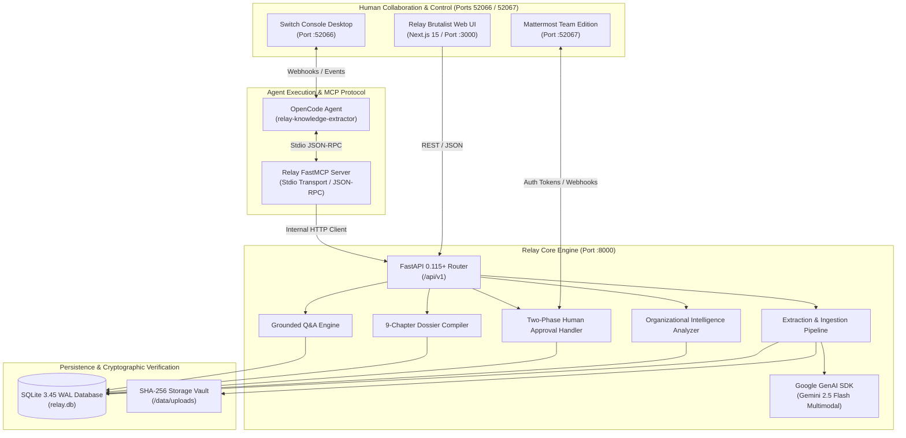

### 4.1 How Organizational Knowledge is Structured

Relay avoids the opacity of vector-only databases by maintaining a rigorous relational model of institutional truth. Extracted facts and entities are first-class relational citizens directly linked to raw textual coordinates:

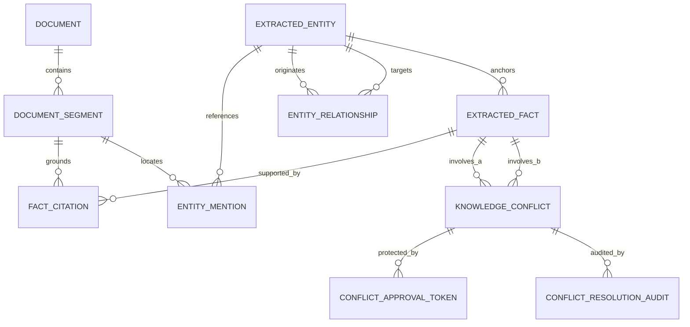

Every `ExtractedFact` persisted in Relay requires:
* An exact `category` (`decision`, `milestone`, `deadline`, `responsibility`, `financial`).
* An anchor `primary_entity_id`.
* A verification score and reviewer status (`evidence-backed`, `in-flight`, `rejected`).
* At least one `FactCitation` record containing the exact segment ID, character offsets (`char_start`, `char_end`), and verbatim quotation from the primary document.

---

### 4.2 Evidence-Grounded Extraction Pipeline

Raw document processing in Relay follows a strict, multi-stage deterministic pipeline. 

```
Raw Archive File (.txt / .pdf)
       │
       ▼
[Deterministic Chunking & Character Offsets] ──> DocumentSegment [char_start, char_end]
       │
       ▼
[Gemini Structured Extraction (Pydantic Schema)]
       │
       ├── Extracted Entities (person, project, asset, organization)
       ├── Entity Relationships (OWNS, STEWARDS, REPORTS_TO, SUPERSEDES)
       └── Candidate Facts with Verbatim Quotes
       │
       ▼
[Strict Verification Gate]
       │
       ├── Locate verbatim quote inside segment text
       ├── Validate exact offset coordinates
       └── REJECT any candidate fact where quotation cannot be matched
```

Here is the actual implementation from our grounding and extraction services (`backend/app/services/grounding.py` and `backend/app/services/intelligence_service.py`):

```python
# Verbatim Citation Offset Validation & Invariant Gate
# backend/app/services/intelligence_service.py
if cit_res.is_valid:
    cit_key = (cit_res.segment_id, cit_res.char_start, cit_res.char_end, "valid")
    if cit_key in existing_cit_keys:
        continue

    # Exact slicing invariant verification before persistence
    seg = segment_map.get(cit_res.segment_id)
    if seg:
        assert seg.content[cit_res.char_start:cit_res.char_end] == cit_res.verbatim_quote

    citation = FactCitation(
        id=str(uuid.uuid4()),
        fact_id=fact_record.id,
        document_segment_id=cit_res.segment_id,
        verbatim_quote=cit_res.verbatim_quote or raw_quote,
        source_location=cit_res.source_location,
        char_start=cit_res.char_start,
        char_end=cit_res.char_end,
        verification_status="valid",
        rejection_reason=None,
    )
    db.add(citation)
    existing_cit_keys.add(cit_key)
    persisted_citations.append(citation)
else:
    # Explicit rejection: preserve ungrounded claims with rejection reason
    citation = FactCitation(
        id=str(uuid.uuid4()),
        fact_id=fact_record.id,
        document_segment_id=cit_res.segment_id,
        verbatim_quote=raw_quote,
        source_location=cit_res.source_location,
        char_start=None,
        char_end=None,
        verification_status="rejected",
        rejection_reason=cit_res.rejection_reason,
    )
    db.add(citation)
```

If an LLM hallucinates an assertion that cannot be verified byte-for-byte in the uploaded file, the citation verification gate rejects it immediately.

---

### 4.3 Property-Aware Conflict Detection

A major failure mode of naive AI systems is string-matching contradiction detection. If Document A says *"The team is targeting November 15 for launch"* and Document B says *"November 15 is our target launch date"*, naive text comparison models frequently flag them as contradictory simply because the sentences use different words.

Relay implements **Property-Aware Semantic Matching** in `backend/app/services/intelligence_analyzer.py`:

1. **Semantic Profile Extraction**: Every fact is broken down into a structured profile:
   * `entity_key`: e.g. `project:odyssey`
   * `prop_key`: e.g. `project:odyssey:milestone:beta`
   * `normalized_value`: e.g. `date:2026-11-15`
   * `amendment_markers`: regex detection of words like *amend*, *supersede*, *postpone*, *reschedule*, *extend*.
2. **Category-Specific Conflict Logic**:
   * **Contradiction**: Two facts share identical `entity_key` and `prop_key`, but have incompatible `normalized_value`s, and **neither** fact contains an amendment marker.
   * **Superseded Decision**: Incompatible values exist, but one fact contains an explicit amendment marker or comes from an amendment memo.
   * **Ownership Gap**: Entities categorized as `asset` or `project` that have zero incoming stewardship relations.
   * **Evidence Gap**: Facts with verification status `rejected` or lacking supporting citations.

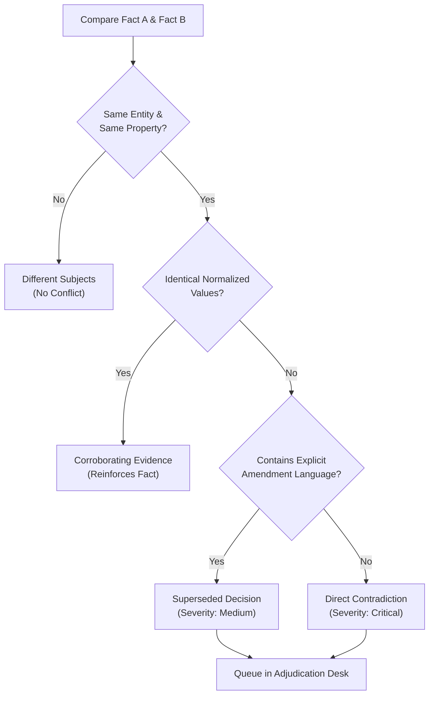

---

### 4.4 The Relay FastMCP Server

Relay exposes five dedicated tools to autonomous agents via the **Model Context Protocol (MCP)** using stdio JSON-RPC transport (`backend/app/integrations/switch/mcp_server.py`):

| Tool Name | Parameters | Purpose | Permission & Security Model |
|:---|:---|:---|:---|
| `relay_deposit_document` | `title: str`, `text: str` | Ingests, segments, extracts facts, and scans conflicts for new records. | Agent-executable; triggers automated extraction and indexing. |
| `relay_ask_question` | `question: str` | Queries institutional memory using natural language with strict grounding. | Agent-executable; returns answers, verbatim quotes, and confidence scores. |
| `relay_get_conflicts` | `status: str`, `severity: Optional[str]` | Lists active organizational contradictions, gaps, and discrepancies. | Agent-executable; read-only audit of institutional discrepancies. |
| `relay_request_conflict_resolution` | `conflict_id: str`, `resolution_notes: str`, `proposed_status: str` | Initiates two-phase human review; returns a secure review URL and token ID. | Agent-executable; **cannot resolve conflict**; queues pending human review. |
| `relay_resolve_conflict` | `conflict_id: str`, `resolution_notes: str`, `approval_token: str` | Finalizes conflict adjudication and seals the immutable audit log. | **Hard Security Gate**: Strictly requires a valid, unconsumed, human approval token. |

Here is the exact agent configuration from our Switch/OpenCode workspace (`opencode.jsonc`):

```jsonc
{
  "$schema": "https://opencode.ai/config.json",
  "mcp": {
    "relay": {
      "type": "local",
      "command": [
        "python",
        "-m",
        "app.integrations.switch.mcp_server"
      ],
      "environment": {
        "RELAY_API_URL": "http://127.0.0.1:8000"
      }
    }
  },
  "permission": {
    "*": "allow",
    "relay_*": "allow"
  }
}
```

---

### 4.5 How the Switch Agent Investigates

When an incoming leader asks a question in the Switch chat interface (e.g. *"What is the confirmed launch timeline for Project Odyssey?"*), the OpenCode agent does not guess. It performs a multi-step investigation across Relay's MCP tools:

```
[Incoming Leader] ──> Switch Room: "What is the confirmed timeline for Project Odyssey?"
                            │
                            ▼
[OpenCode Agent] ──> Tool Call: relay_get_conflicts(status="open")
                            │
                            ▼
[Relay MCP]      ──> Returns: Conflict #f11b799f (Direct Contradiction: Nov 15 vs Dec 20)
                            │
                            ▼
[OpenCode Agent] ──> Tool Call: relay_ask_question("Odyssey schedule amendment reason")
                            │
                            ▼
[Relay MCP]      ──> Returns: "Amended following testing on Kubernetes cluster Alpha-9"
                            │
                            ▼
[OpenCode Agent] ──> Formulates Grounded Response in Switch:
                     "Project Odyssey has two conflicting recorded dates:
                      1. Nov 15, 2026 (Project Odyssey Launch Plan.txt)
                      2. Dec 20, 2026 (Project Odyssey Schedule Amendment Memo.txt)
                      This discrepancy is currently FLAGGED as Conflict #f11b799f.
                      Would you like me to request human adjudication to ratify Dec 20?"
```

The agent actively recognizes when institutional records disagree, accurately explains the context, and guides the human toward formal adjudication rather than smoothing over the discrepancy.

---

### 4.6 Two-Phase Human Approval & Zero-Trust Governance

If an AI agent could resolve conflicts unilaterally, an adversary could prompt-inject an agent to overwrite company policies, reassign intellectual property, or dismiss financial liabilities.

Relay eliminates this vulnerability with **Two-Phase Human Governance**:

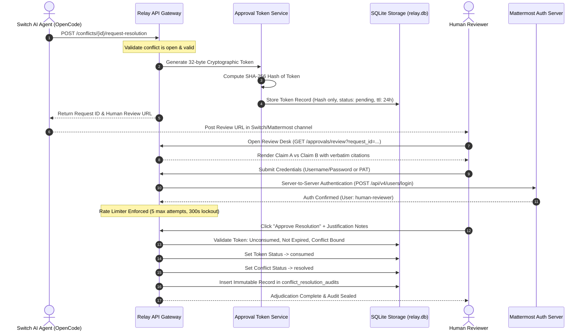

#### Replay Protection & Identity Verification Implementation

```python
# backend/app/services/approval_service.py
@classmethod
def human_adjudicate_request(
    cls,
    db: Session,
    request_id: str,
    decision: str,
    approver_id: Optional[str] = None,
    mattermost_token: Optional[str] = None,
    operator_secret: Optional[str] = None,
    decision_notes: Optional[str] = None,
) -> Tuple[ConflictApprovalToken, Optional[KnowledgeConflict]]:
    # 1. Anti-Spoofing Gate: Derive approver identity strictly from Mattermost session
    # Caller-supplied approver_id strings in the JSON body are strictly ignored
    if mattermost_token and mattermost_token.strip():
        profile = MattermostAuthService.verify_session_token(mattermost_token)
        verified_approver = profile["verified_approver_id"]
        verified_auth_type = "mattermost_session"
    elif operator_secret and operator_secret.strip() == settings.SWITCH_OPERATOR_SECRET:
        verified_approver = approver_id.strip() if approver_id and approver_id.strip() else "switch_operator"
        verified_auth_type = "switch_operator_secret"
    else:
        raise UnauthorizedApproverError("Authentication required: Invalid credentials.")

    record = db.query(ConflictApprovalToken).filter(ConflictApprovalToken.id == request_id).first()
    if not record:
        raise ApprovalRequestNotFoundError(f"Approval request '{request_id}' not found.")

    # 2. Replay Protection: Check if already consumed or rejected
    if record.status == "consumed":
        raise TokenAlreadyConsumedError("Approval token has already been consumed.")
    if record.status == "rejected":
        raise TokenRejectedError("Approval request was already rejected.")

    # 3. Expiration Check
    now = datetime.now(timezone.utc)
    exp = record.expires_at.replace(tzinfo=timezone.utc) if record.expires_at.tzinfo is None else record.expires_at
    if exp < now:
        record.status = "expired"
        db.commit()
        raise TokenExpiredError("Approval request has expired.")

    # 4. Atomic Consumption & Immutable Audit Logging
    record.status = "consumed"
    record.consumed_at = now
    
    conflict = db.query(KnowledgeConflict).filter(KnowledgeConflict.id == record.conflict_id).first()
    conflict.status = record.proposed_status
    conflict.resolved_by = verified_approver
    conflict.resolved_at = now
    
    audit = ConflictResolutionAudit(
        id=str(uuid.uuid4()),
        conflict_id=record.conflict_id,
        approval_token_id=record.id,
        decision="approved",
        approver_id=verified_approver,
        approver_auth_type=verified_auth_type,
        resolution_notes=f"[APPROVED by {verified_approver}] {decision_notes or record.resolution_notes}",
        token_hash=record.token_hash,
    )
    db.add(audit)
    db.commit()
    return record, conflict
```

Raw tokens are generated using Python's `secrets.token_urlsafe(32)`. The raw token is returned to the client once; only its SHA-256 hash is persisted in the database.

---

### 4.7 Nine-Chapter Handover Dossier & Roadmap Generation

Relay compiles institutional memory into a boardroom-ready **9-Chapter Executive Briefing Book** (`backend/app/services/dossier_service.py`):

| Chapter | Title | Focus & Contents |
|:---:|:---|:---|
| **01** | **Executive Mandate & Operational Health** | Total records ingested, entities indexed, readiness telemetry, baseline health metrics. |
| **02** | **Active Initiatives & Milestone Delivery** | Detailed delivery tracking for Project Odyssey, Project Aegis, Project Nova. |
| **03** | **Responsibility Matrix & Stewardship Hierarchy** | Reporting relationships, active owners, and RACI delegations. |
| **04** | **Strategic Decisions & Amendment Lineage** | Chronological ledger of ratified strategic decisions alongside superseded history. |
| **05** | **Pending Deliverables & Critical Commitments** | Time-sensitive deliverables, financial thresholds, and contractual obligations. |
| **06** | **Discrepancy Ledger & Adjudication Queue** | Unresolved contradictions segregated from human-adjudicated resolutions. |
| **07** | **Ownership Gaps & Institutional Hazards** | Unassigned infrastructure assets (e.g. *Kubernetes cluster Alpha-9*). |
| **08** | **Institutional Contacts & System Dependencies** | Verified directory of key personnel and infrastructure dependencies. |
| **09** | **Source Document Archive & Citation Register** | Complete bibliographic provenance register of all deposited primary sources. |

Accompanying the dossier is a chronological **Day 1–30 Operational Roadmap**:
* **Phase 1 (Days 1–7: Orientation & Bilateral Briefing)**: Formal bilateral handover sessions between outgoing leader Aman Kumar and incoming successor Marcus Vance.
* **Phase 2 (Days 8–14: Discrepancy Adjudication & Infrastructure Stewardship)**: Formal assignment of Kubernetes cluster Alpha-9 ownership.
* **Phase 3 (Days 15–21: Stakeholder Alignment & Architecture Review)**: Align engineering units on the postponed February 1, 2027 Project Aegis Beta date.
* **Phase 4 (Days 22–30: Operational Autonomy & Readiness Gate)**: Pre-flight verification for Project Nova reliability testing and formal signing of the transition book.

---

### 4.8 Grounded Q&A with Honest Refusal

A critical requirement for institutional intelligence is knowing when to say *"I don't know."*

In `backend/app/services/qa_service.py`, when a user queries Relay:
1. Relay extracts specific domain tokens, discarding common stop words and generic domain terms.
2. It scores facts based on exact token matches against statements, categories, and canonical entity names.
3. If no facts achieve a minimum grounding threshold, Relay returns:

```json
{
  "answer": "Insufficient evidence in current institutional records. The deposited documentation does not contain verified claims regarding this topic.",
  "confidence_score": 0.0,
  "has_sufficient_evidence": false,
  "citations": []
}
```

The system never hallucinates answers to fill gaps.

---

## 5. Technology Stack & Architectural Fit

Every tool in Relay's stack was selected to solve a concrete engineering requirement:

| Technology | Responsibility | Engineering Rationale |
|:---|:---|:---|
| **Python 3.12 & FastAPI** | Core REST API & Business Services | Native async support, high performance, clean Pydantic v2 data validation schemas. |
| **SQLite 3.45 with WAL** | Local-First Persistent Relational Engine | Single-file zero-configuration database; Write-Ahead Logging allows concurrent reads during writes. |
| **Google GenAI SDK (Gemini Flash)** | Multimodal Structured Knowledge Extraction | Native JSON schema enforcement with fast inference speeds and large token context windows. |
| **FastMCP (Model Context Protocol)** | AI Agent Interface Standard | Open standard protocol connecting autonomous agents to local tools via clean stdio JSON-RPC. |
| **Switch Console & OpenCode** | Agent Orchestration & Workspace Collaboration | Developer-native environment allowing AI agents and human reviewers to collaborate in chat rooms. |
| **Mattermost Team Edition** | Human Authentication & Webhook Target | Secure, open-source enterprise chat supporting server-to-server user verification via Personal Access Tokens. |
| **Next.js 15 (App Router) & React 19** | Industrial Editorial Brutalist UI | Server-side rendering, instant page transitions, strict TypeScript type safety, and custom SVG visualizers. |
| **Docker & Docker Compose** | Reproducible Deployment | Encapsulates the Python backend and database environment with zero host configuration drift. |

---

## 6. A Visual Tour of the Application

### 6.1 The Executive Continuity Dashboard
The primary command center displays real-time continuity scores, dynamic knowledge metrics, and direct alerts for open contradictions.

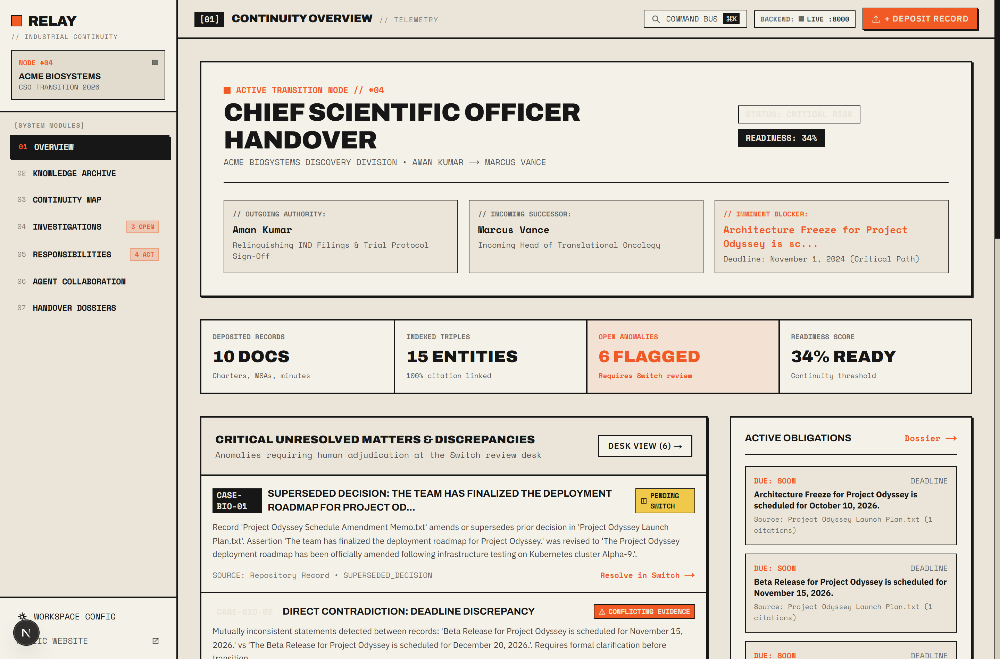
*Figure 1: The Relay Executive Dashboard rendering real-time readiness telemetry, indexed entity counts, and active conflict tallies.*

---

### 6.2 Document Ingestion & Verbatim Evidence Inspector
Depositing records automatically triggers segmentation and citation anchoring. Every statement can be inspected down to its verbatim offset.

| Document Archive Index | Extracted Evidence & Citations |
|:---:|:---:|
| 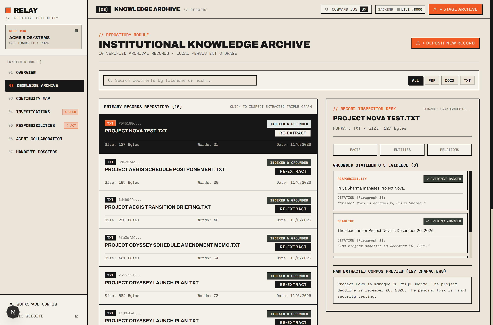 | 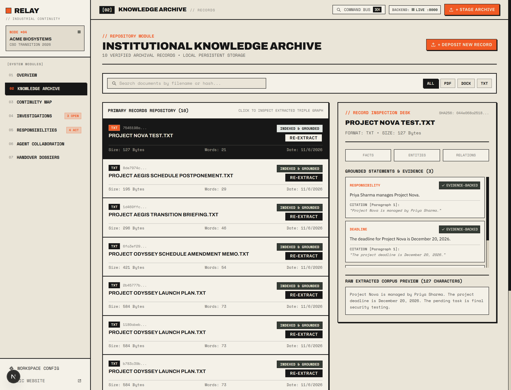 |
| *Figure 2: Ingested documents with SHA-256 verification hashes.* | *Figure 3: Inspecting extracted facts linked to character offsets.* |

---

### 6.3 Discrepancy Intelligence & Investigations
Relay cross-examines competing claims side-by-side, displaying exact source documents and highlighting conflicting dates.

| Direct Contradiction Comparison | Unassigned Ownership Gap |
|:---:|:---:|
| 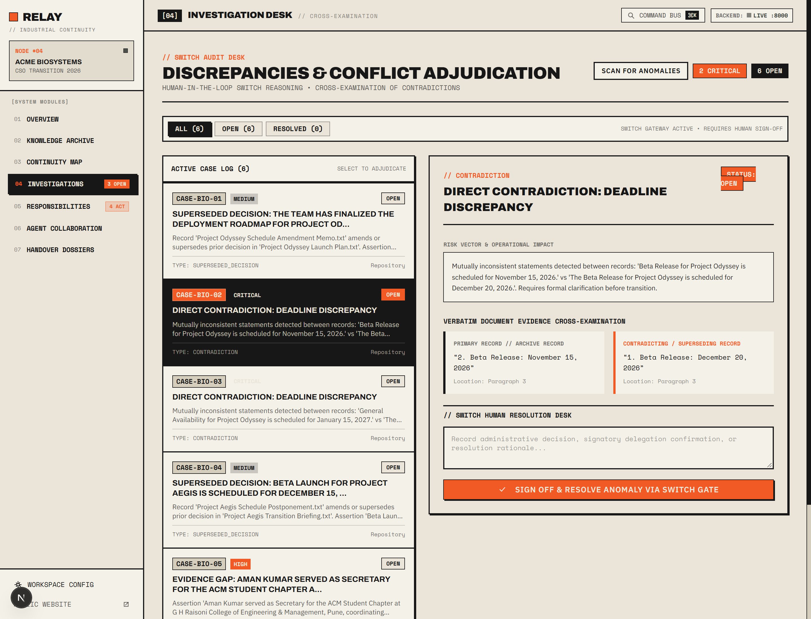 | 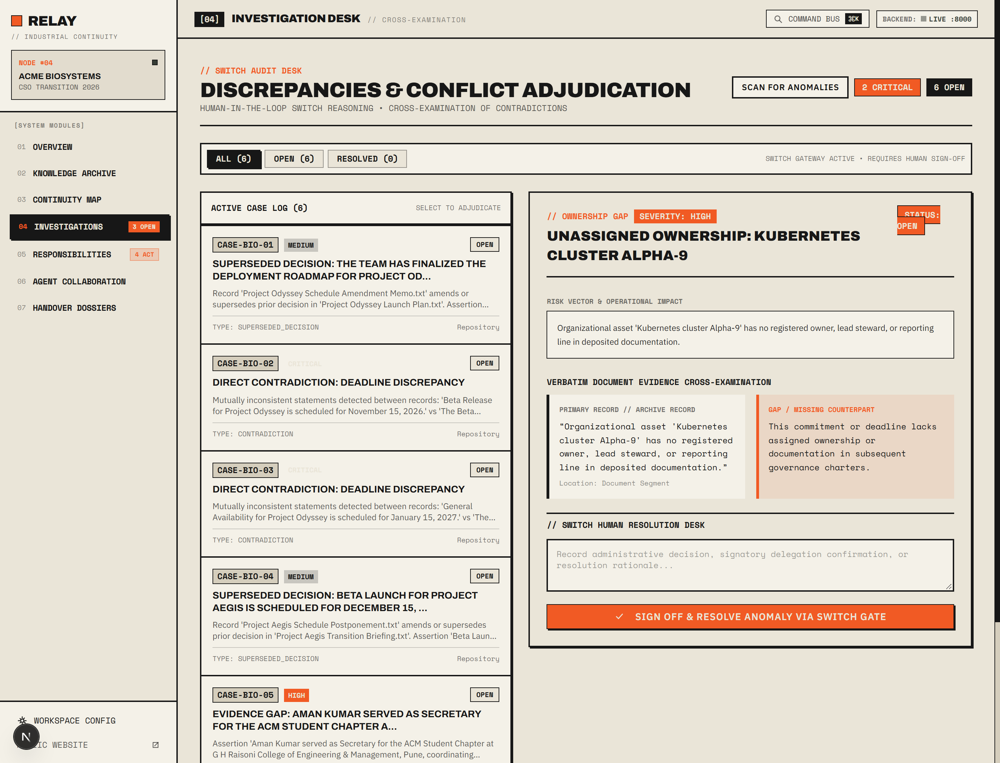 |
| *Figure 4: Comparing conflicting Odyssey launch dates (Nov 15 vs Dec 20).* | *Figure 5: Highlighting Kubernetes cluster Alpha-9 as an unassigned asset.* |

---

### 6.4 The Dynamic Continuity Map
An interactive SVG topological radar that maps relationships between people, documents, projects, and unresolved gaps.

| Topology Radar Mode | Accessible Entity Ledger Mode |
|:---:|:---:|
| 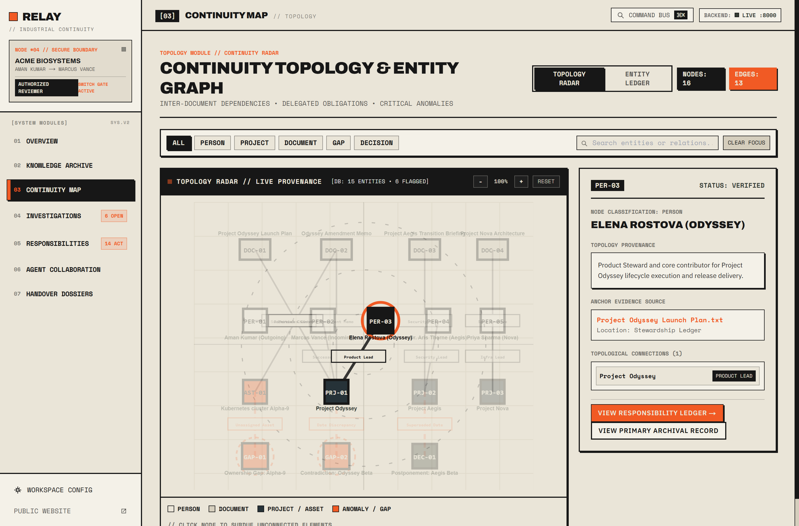 | 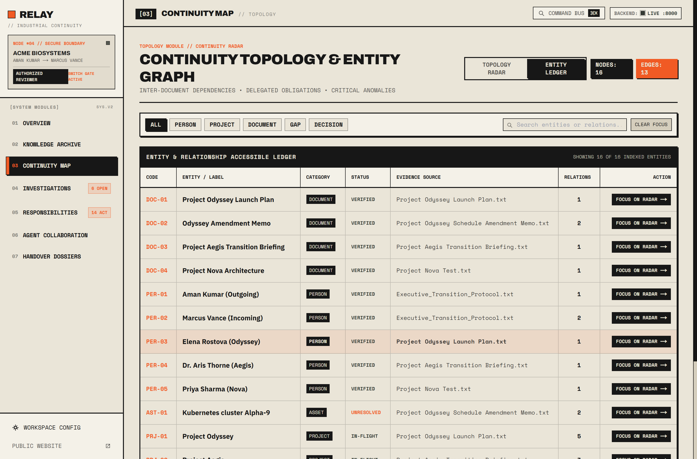 |
| *Figure 6: Interactive radar with zoom/pan controls and node subduing focus.* | *Figure 7: Tabular entity ledger offering accessible table navigation.* |

---

### 6.5 Two-Phase Human Review Desk & Mattermost Authentication
When an agent requests conflict resolution, human reviewers authenticate server-to-server through Mattermost to ratify decisions.

| Two-Phase Human Review Screen | Mattermost Reviewer Login |
|:---:|:---:|
| 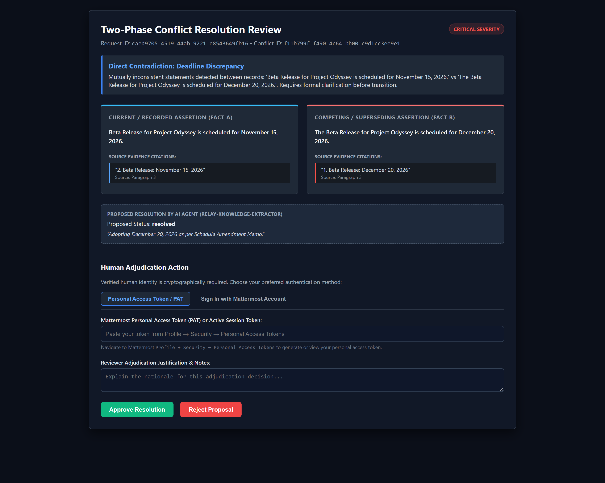 | 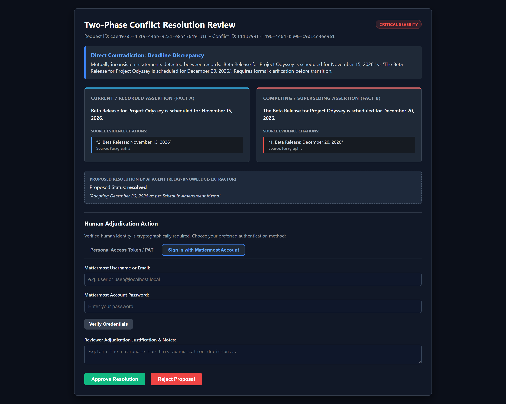 |
| *Figure 8: Human review desk showing competing claims and evidence.* | *Figure 9: Secure server-to-server Mattermost credential verification.* |

---

### 6.6 The 9-Chapter Handover Dossier & Grounded Q&A
The platform synthesizes institutional memory into an evidence-backed briefing book paired with a grounded natural-language search desk.

| 9-Chapter Executive Briefing Book | Zero-Hallucination Grounded Q&A |
|:---:|:---:|
| 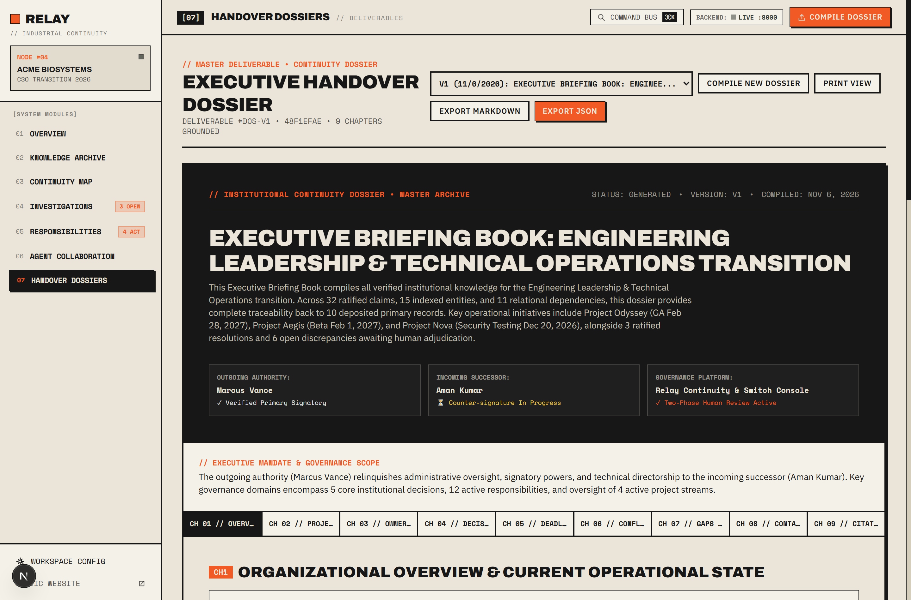 | 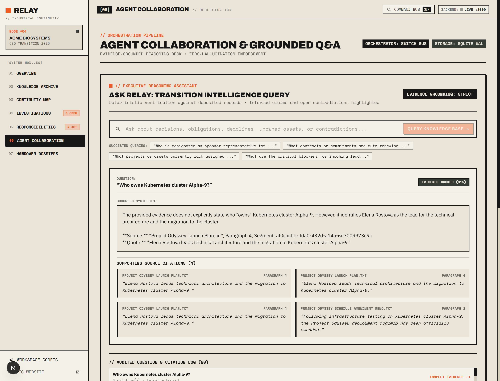 |
| *Figure 10: Chapter navigation across projects, decisions, and roadmaps.* | *Figure 11: Grounded question answering returning verbatim quotations.* |

---

## 7. How to Run Relay Locally

### Prerequisites
* **Python**: v3.11 or v3.12
* **Node.js**: v18.0.0 or higher
* **Docker Desktop**: With Docker Compose v2+
* **Git**: Installed and configured

### Step 1: Clone the Repository
```bash
git clone https://github.com/Amankumar0018/Relay.git
cd Relay
```

### Step 2: Environment Configuration
Copy the environment template files:
```bash
cp .env.example .env
cp backend/.env.example backend/.env
```

Configure your `backend/.env` with your Google Gemini API key:
```env
GEMINI_API_KEY=your_google_gemini_api_key
SWITCH_OPERATOR_SECRET=generate_a_random_32_char_secret_string
DATABASE_URL=sqlite:///./relay.db
```

### Step 3: Start the Backend via Docker
```bash
docker compose up -d --build
```

Verify backend health:
```bash
curl http://localhost:8000/health
# Expected: {"status":"ok","database":"connected","environment":"development","version":"0.1.0"}
```

### Step 4: Run the Next.js Frontend
```bash
cd frontend
npm install
npm run build
npm run start
```
Open [http://localhost:3000](http://localhost:3000) in your browser.

### Step 5: Configure OpenCode / Switch Agent
Add the Relay FastMCP server to your Switch agent's `opencode.jsonc`:
```jsonc
{
  "mcp": {
    "relay": {
      "type": "local",
      "command": ["python", "-m", "app.integrations.switch.mcp_server"],
      "environment": {
        "RELAY_API_URL": "http://127.0.0.1:8000"
      }
    }
  }
}
```

---

## 8. What Relay Still Gets Wrong (Genuine Limitations)

Engineering integrity requires acknowledging where a system currently reaches its boundaries:

1. **Dependence on Source Document Cleanliness**: Relay performs exceptionally on digital text memos and PDFs with clean typography. However, poorly scanned PDFs with heavy OCR noise can produce fragmented character offsets, causing the strict citation verification gate to reject valid facts.
2. **Synchronous Extraction Latency**: Document extraction currently runs synchronously during HTTP requests. Ingesting an 80-page financial contract can take 25–40 seconds while Gemini processes structured entity schemas. A production deployment requires an asynchronous Celery/Redis task queue.
3. **Local SQLite Concurrency Constraints**: SQLite in WAL mode easily handles concurrent reads, but write transactions (such as bulk uploads during active human adjudication) are serialized. Enterprise enterprise multi-tenant deployments must migrate to PostgreSQL.
4. **Local Mattermost Instance Binding**: The current implementation authenticates against a local Mattermost container on port `:52067`. Production enterprise rollouts require configuring OAuth 2.0 PKCE with corporate Okta/Azure AD identity providers.
5. **False Positive Sensitivity in Semantic Clustering**: Relay intentionally biases toward over-flagging potential contradictions rather than missing a genuine discrepancy. In rare edge cases, two loosely related tasks sharing a property key may trigger a review flag that requires human dismissal.

---

## 9. What We Learned

Building Relay produced five concrete engineering takeaways:

1. **Extraction without character offsets is hallucination waiting to happen.** Summarizing a document into bullet points without binding each point to exact source coordinates (`char_start`, `char_end`) breaks the chain of custody. When executives make high-stakes decisions, they need to see the exact paragraph in the primary record.
2. **Contradiction detection requires property-aware categorization, not vector similarity.** Embedding models measure semantic relatedness, not logical consistency. Two sentences claiming opposite dates are semantically almost identical, yet logically contradictory. Explicit property profiling (`entity:property:value`) is essential.
3. **AI agents should never possess authority over human decisions.** Giving an LLM agent write access to resolve company conflicts is an architectural anti-pattern. The agent's role is forensic discovery and recommendation; ratification must remain human.
4. **Approval workflows require cryptographic single-use tokens.** Simple webhook calls or string parameters (e.g. `authorized_by="admin"`) can be forged or replayed by compromised agent runtimes. Cryptographically random single-use tokens with stored hashes eliminate agent impersonation.
5. **Grounded refusal is more valuable than a guess.** An incoming executive would rather be told *"The archives do not contain documentation regarding this server cluster"* than receive a plausible-sounding hallucination that causes a production outage.

---

## 10. Where Relay Goes Next

* **Hybrid Dense-Sparse Concordance (`pgvector` + BM25)**: Combining keyword-exact coordinate retrieval with vector embeddings to scale across hundreds of thousands of institutional records.
* **Real-Time WebSocket Conflict Feeds**: Pushing immediate contradiction alerts into active Mattermost and Switch rooms the second an inconsistent memo is uploaded.
* **Automated Spoken Meeting Grounding**: Ingesting recorded transition handover meetings via the Gemini Live API, converting spoken commitments into verified citations.
* **Multi-Tenant Workspace Partitioning**: Cryptographic multi-tenant organization boundaries for private enterprise advisory and M&A due diligence.

---

## 11. Closing & Discussion

Organizations do not fail because they lack data. They fail because their institutional truth fragments across departures, unlinked cloud drives, and undocumented assumptions.

When a leader moves on, their successor shouldn't have to start from zero.

By combining deterministic citation grounding, continuous contradiction detection, cryptographic human governance, and structured dossier synthesis, Relay transforms ephemeral organizational context into an uncorrupted institutional memory.

**A Question for Discussion:**  
*Where should the line be drawn between what an AI agent can autonomously decide and what must require cryptographic human approval in enterprise operations?*

Let me know your thoughts in the comments below!

---

## 12. Verified Links & References

* **Relay GitHub Repository**: [https://github.com/Amankumar0018/Relay](https://github.com/Amankumar0018/Relay)
* **Flip the Switch Hackathon**: [WeMakeDevs Hackathon Portal](https://wemakedevs.org)
* **Model Context Protocol (MCP)**: [Anthropic MCP Specification](https://modelcontextprotocol.io)
* **Google GenAI Python SDK**: [Google DeepMind Gemini Documentation](https://ai.google.dev)
* **FastAPI Framework**: [FastAPI Documentation](https://fastapi.tiangolo.com)
* **Mattermost API Reference**: [Mattermost Developer Documentation](https://api.mattermost.com)

